# IUAFC Church Management – Android app

[](https://github.com/Rosebank-Project/iuafc-mobile/actions/workflows/android.yml)
[](https://github.com/Rosebank-Project/iuafc-mobile/actions/workflows/database.yml)

Native Android app for **The International United Apostolic Faith Church (IUAFC)**. It manages members,
ministries, events, attendance, donations, announcements and ministry activities, and gives each person
the screens that match their role in the church.

The app and the church website ([iuafc.vercel.app](https://iuafc.vercel.app),
[source](https://github.com/Rosebank-Project/iuafc)) share one Supabase database, so anything recorded on
the phone appears on the website and the other way round.

Built by **ALAVUMIRO TECH CONSULTANTS** for XISD6329 (Work Integrated Learning), The IIE Rosebank College.

▶️ **[Watch the demo video on YouTube](https://www.youtube.com/watch?v=VqWli9sT0PE)** – every feature of the app on a real Android phone, with a voice-over.

<p>
  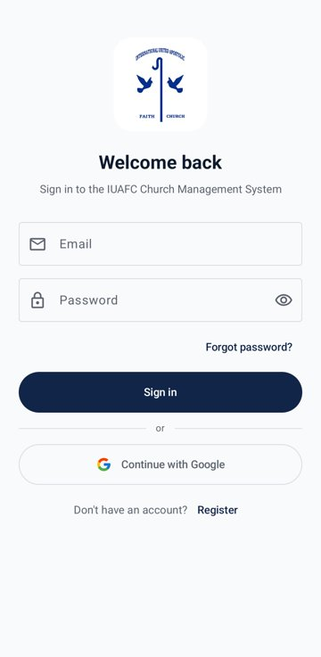
  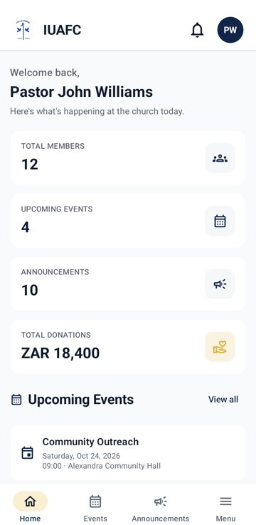
  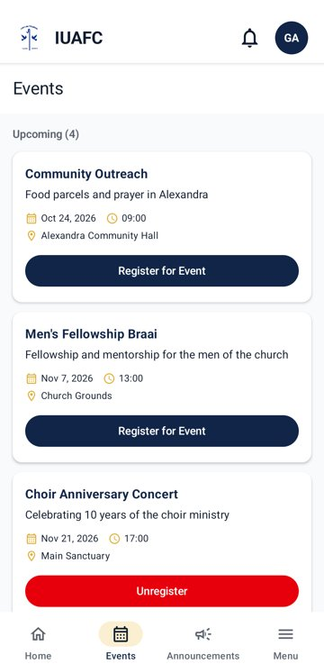
  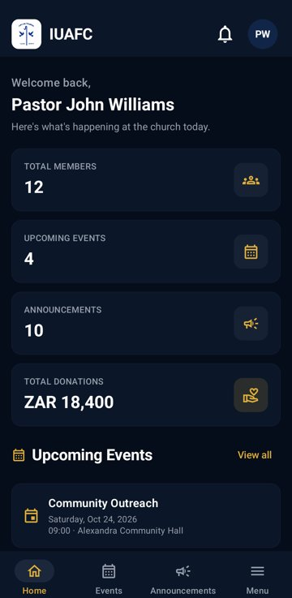
</p>

## Contents
- [Purpose](#purpose)
- [Features](#features)
- [Screenshots](#screenshots)
- [Tech stack](#tech-stack)
- [Design decisions](#design-decisions)
- [Getting started](#getting-started)
- [Testing](#testing)
- [How we used GitHub and GitHub Actions](#how-we-used-github-and-github-actions)
- [Documentation](#documentation)
- [Release notes](#release-notes)
- [Team](#team)

## Purpose

IUAFC kept its member records, attendance and giving on paper and spreadsheets, which made reports slow
and information hard to share between the pastor, the finance officer and the ministry leaders. The app
brings everything into one place:

- the **church office** keeps member records and announcements up to date;
- **leaders** plan activities and capture attendance at the event;
- the **finance officer** records giving and issues receipts;
- **members** see upcoming events, register, and check their own attendance and giving.

## Features

| Feature | Who can use it |
|---|---|
| Register, sign in with email and password, or **sign in with Google** (single sign-on) | Everyone |
| Forgot password (reset link by email) | Everyone |
| Role-based **dashboard** with the numbers that matter to each role | Everyone |
| **Events**: upcoming and past events, details, register / unregister | Everyone (register: Church Member) |
| Create, edit and delete events | Administrator, Pastor |
| **Announcements**: read; create, edit and delete | Everyone; Administrator, Pastor |
| **Notifications** for announcements, events and reviewed activities, with read / unread | Everyone |
| **Settings**: edit profile, light / dark / system theme, notifications, password reset, help, sign out | Everyone |
| **Help** – searchable questions and answers per feature | Everyone |
| **Members**: search, filter by ministry, sort, details, add, edit, remove | Administrator, Pastor (manage: Administrator) |
| **Users**: change a person's role and link them to their member record or ministry | Administrator |
| **Ministries** with their leaders | Administrator, Pastor, Ministry Leader (manage: Administrator) |
| **Ministry activities**: leaders propose, the pastor approves or rejects with a note | Ministry Leader, Pastor, Administrator |
| **Attendance**: pick an event and mark each member present or absent | Administrator, Pastor, Ministry Leader (own ministry) |
| **My attendance** | Church Member |
| **Donations**: tithes, offerings and donations with automatic receipt numbers | Finance Officer, Administrator (record); Pastor (view); Church Member (own) |
| **Reports**: membership, giving by month and type, attendance by event and month | Administrator, Pastor |

Every form validates its input (required fields, email, South African phone numbers, amounts, dates
that can't be in the past or the future) and shows a message next to the field instead of crashing.

## Screenshots

| Members | Activities | Attendance | Donations |
|---|---|---|---|
| 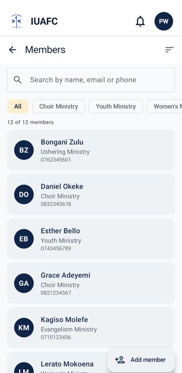 | 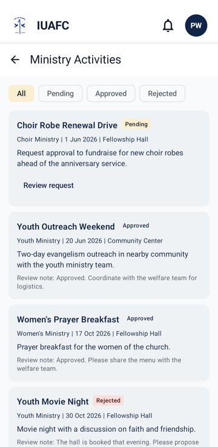 | 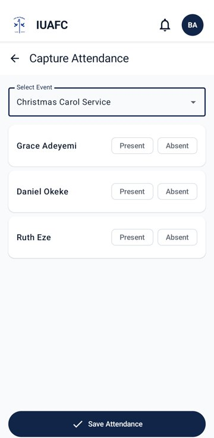 | 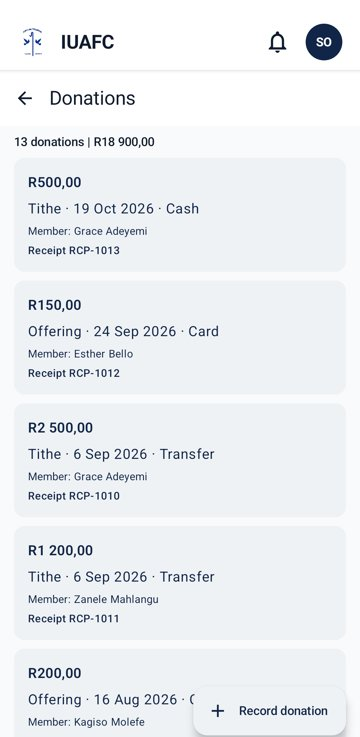 |

| Announcements | Reports | Users and roles | Settings |
|---|---|---|---|
| 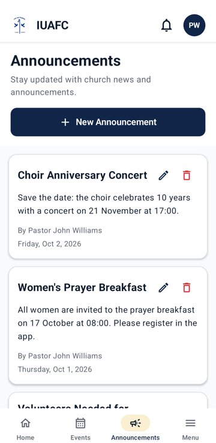 | 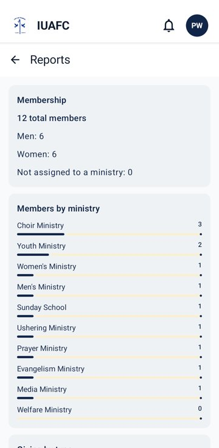 | 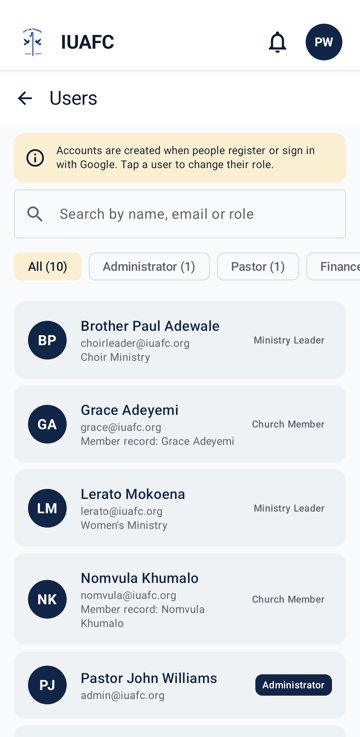 | 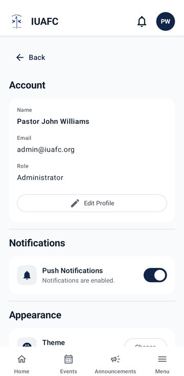 |

The [user manual](docs/user-manual.pdf) has every screen, labelled, for every role.

## Tech stack

| Area | Technology |
|---|---|
| Language and UI | Kotlin 2.4, Jetpack Compose, Material 3 |
| Architecture | MVVM (Screen → ViewModel → Repository), Navigation Compose with type-safe routes |
| Backend / API | [Supabase](https://supabase.com): PostgreSQL, PostgREST API, Auth, Row Level Security, SQL functions |
| Supabase client | supabase-kt 3.8 (Auth + Postgrest), Ktor OkHttp |
| Sign-in with Google | Android Credential Manager → Supabase ID-token sign-in |
| Local settings | Jetpack DataStore |
| Tests | JUnit 4, kotlinx-coroutines-test, Compose UI tests (instrumented) |
| CI/CD | GitHub Actions (build, unit tests, UI tests on an emulator, database migrations) |
| Website | Next.js on Vercel, same Supabase project |

Android: `minSdk 26`, `targetSdk 36`, `compileSdk 37`.

## Design decisions

- **One database for the app and the website.** Supabase gives a PostgreSQL database with a ready REST
  API, authentication and Row Level Security, so we didn't have to host our own server. Both clients call
  the same API, which keeps the data in sync.
- **Security in the database, not only in the app.** Row Level Security policies decide what each role can
  read and change (for example, a Church Member only sees their own donations, and only a Finance Officer or
  Administrator can record one). Roles can only be changed through the `set_user_role()` function, which
  checks that the caller is an Administrator. Passwords are hashed by Supabase Auth and never stored by us.
- **MVVM with repositories.** Each screen talks to a ViewModel, and each ViewModel to a repository
  interface. The repositories have a Supabase version and a mock version, so the app also runs in **demo
  mode** without keys (pick a role and try every screen offline), and the unit tests never need the network.
- **Database changes as code.** Every table, policy and sample record is a migration in
  `supabase/migrations/`. GitHub Actions applies them when a pull request is merged, so the database always
  matches `main`.
- **Same look as the website.** The navy and gold colours of the church website, a consistent header and
  bottom navigation, light and dark themes, and the same wording on both.
- **Accessible, forgiving forms.** Validation messages under each field, date pickers that block invalid
  dates, confirmation before deleting, and friendly error messages (for example "No internet connection").

More detail: [architecture](docs/architecture.md) · [database and ERD](docs/database.md) ·
[migrations](docs/database-migrations.md) · [Google sign-in](docs/google-sign-in.md).


## Getting started

### Requirements
- Android Studio (latest stable) with the **Android SDK 37.1** platform
- JDK 21
- An Android phone or emulator with Android 8.0 (API 26) or later

### Run the app
1. Clone the repository and open it in Android Studio.
2. **Demo mode (no setup):** just run the app. Without Supabase keys it opens a role picker and uses
   sample data, so every screen can be tried offline.
3. **Real data:** add the Supabase keys to `local.properties` in the project root (this file is in
   `.gitignore` and must never be committed):
   ```properties
   SUPABASE_URL=https://<project-ref>.supabase.co
   SUPABASE_ANON_KEY=<publishable key>
   GOOGLE_WEB_CLIENT_ID=<web OAuth client id>   # optional, enables "Continue with Google"
   ```
   See [docs/supabase-setup.md](docs/supabase-setup.md). For Google sign-in, your debug key's SHA-1 must be
   registered first ([docs/google-sign-in.md](docs/google-sign-in.md)).
4. Run the **app** configuration on a phone or emulator.

Test accounts (one per role) are described in [docs/database.md](docs/database.md#test-accounts); the
passwords are shared privately with the team.

## Testing

| Type | Where | How many |
|---|---|---|
| Unit tests (validation, ViewModels with fake repositories, navigation rules, sample data, dashboard) | `app/src/test` | 81 |
| UI tests (sign-in form, member form) | `app/src/androidTest` | 6 |

```bash
./gradlew testDebugUnitTest          # unit tests
./gradlew connectedDebugAndroidTest  # UI tests (needs a running emulator or phone)
```

The full list of test cases, with the manual tests and their results, is in
[docs/testing.md](docs/testing.md).

## How we used GitHub and GitHub Actions

- **Issues and a project board.** Every task was an issue assigned to one member and tracked on the
  [GitHub Projects board](https://github.com/orgs/Rosebank-Project/projects/1) (Backlog → To do →
  In progress → In review → Done).
- **Branches and pull requests.** Each task was built on its own branch (`feature/<name>-<feature>`) and
  merged through a pull request that the tech lead reviewed. Reviews were written on the pull request,
  sometimes with a PDF report and screenshots from the emulator, and fixed before merging.
- **[Android CI](.github/workflows/android.yml)** runs on every pull request and every push to `main`:
  - *Unit tests and build* – runs the unit tests, builds the debug APK and uploads the test reports and
    the APK as artifacts;
  - *UI tests (emulator)* – starts an Android emulator on the runner and runs the instrumented UI tests.
- **[Database migrations](.github/workflows/database.yml)** – on a pull request it does a dry run that
  lists the migrations that would be applied; when the pull request is merged it applies them to Supabase.
- **Secrets** (Supabase keys, database password, access token) are stored as GitHub Actions secrets, never
  in the code.

## Documentation
- [Demo video (YouTube)](https://www.youtube.com/watch?v=VqWli9sT0PE)
- [User manual](docs/user-manual.pdf) – step-by-step guide for every role, with labelled screenshots
- [Test documentation](docs/testing.md)
- [Database, ERD and test accounts](docs/database.md)
- [App architecture](docs/architecture.md)
- In-app **Help** screen (Menu → Help, or Settings → Help & Support)

## Release notes

### Version 1.0 – October 2026
First complete version of the app, built from the Task 1 prototype and the existing website.

**New since the prototype**
- Native Android app in Kotlin and Jetpack Compose with every screen of the website.
- Real accounts with Supabase Auth: register, sign in, password reset and **Google sign-in (SSO)**.
- **Role-based access** for Administrator, Pastor, Finance Officer, Ministry Leader and Church Member, in the
  app and enforced in the database.
- **Shared online database**: the app and the website now read and write the same Supabase tables (the
  website used to keep its data in the browser).
- Members, ministries, events with registration, attendance capture, donations with receipts,
  announcements, notifications, reports and settings.
- Help screen and user manual.

**Innovative features in this version**
- **Activity approval workflow** – Ministry Leaders propose activities for their ministry and the Pastor
  approves or rejects them with a note; the leader is notified.
- **Automatic receipt numbers** for donations, generated by the database so two devices can never issue the
  same number.
- **Dark mode** and a theme setting that follows the phone.
- **Demo mode** – the app runs offline with sample data and a role picker, which made it possible to build
  and test every screen before the database existed.
- **Automated database deployment** – migrations are reviewed in pull requests and applied by GitHub
  Actions.
- **UI tests on an emulator in CI**, on top of the unit tests.

**Fixes before release**
- Every avatar now shows the same initials (the menu used to show different ones from the header).
- Dates can't be in the future for donations, or in the past for new events and proposed activities.
- Attendance is saved with the event's date, and leaders only see their own ministry's members.

## Team

| Member | Role in the project |
|---|---|
| Miguel Domingos | Tech lead: architecture, authentication and Google SSO, Supabase integration, CI/CD, code reviews |
| Rolph Rudolf | Database schema and seed data, Events and Attendance screens, testing |
| Paule Alexandra | Project management, Dashboard, Announcements, Notifications and Settings screens, demo video |
| Avuzwa Kwetana | Donations, Ministries, Activities, Reports and Help screens, documentation |
