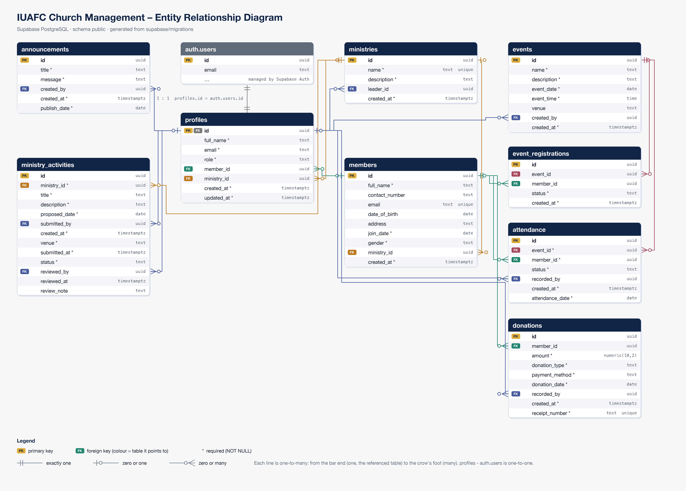
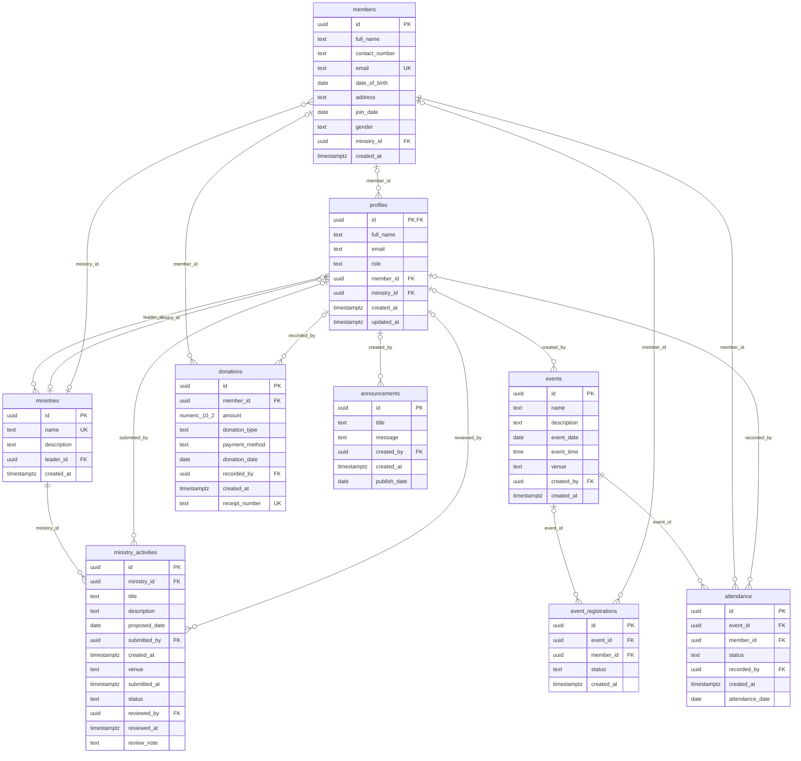

# Database

The app and the website share one **Supabase PostgreSQL** database. Every table, policy and
sample record is created by the migrations in `supabase/migrations/`, which GitHub Actions applies
when a pull request is merged into `main` (see [database-migrations.md](database-migrations.md)).

`docs/erd.png` is the diagram for the report. It was generated from the real schema after
applying every migration, so it shows the actual tables, columns, data types and keys.

## Tables

| Table | What it stores | Rows in the seed |
|---|---|---|
| `profiles` | One row per account (Supabase Auth), with the user's **role**. Linked to their member record and, for Ministry Leaders, their ministry. | from the test accounts |
| `members` | Church members: personal details, gender, date of birth, ministry, join date. | 12 |
| `ministries` | Ministries and their leader (an account). | 10 |
| `events` | Church events: date, time, venue, who created it. | 10 |
| `event_registrations` | Which members registered for which events (a member registers once per event). | 15 |
| `attendance` | Present / absent per member per event (once per member per event). | 12 |
| `donations` | Tithes, offerings and donations with an automatic receipt number (RCP-1001, …). | 12 |
| `announcements` | Notices published by Administrators and Pastors. | 10 |
| `ministry_activities` | Activities proposed by Ministry Leaders and approved or rejected by an Administrator or Pastor. | 10 |

Passwords are never stored in these tables: Supabase Auth keeps them hashed in `auth.users`.

## Design

- **Primary keys:** every table uses a `uuid` generated by the database (`gen_random_uuid()`).
- **Foreign keys** for every relationship. Deleting a parent sets the link to `null`
  (e.g. deleting a member keeps their donations for the financial records), except for
  registrations and attendance, which are removed with their event or member.
- **Data types:** `date` and `time` for events, `numeric(10,2)` for amounts, `timestamptz` for
  timestamps, and `check` constraints for every fixed list (roles, gender, donation type,
  payment method, attendance and activity status).
- **Naming:** `snake_case`, plural table names. The column names match the app
  (`data/model/Models.kt`) and the website (`lib/types.ts`).
- **Row Level Security** is on for every table. Policies use `public.current_user_role()`:

| Table | Read | Create / change |
|---|---|---|
| `profiles` | own profile; Administrator and Pastor read all | own name; roles only through `set_user_role()` (Administrator) |
| `members` | Administrator, Pastor; a member reads their own record | Administrator |
| `ministries` | every signed-in user | Administrator |
| `events` | every signed-in user | Administrator, Pastor |
| `event_registrations` | Administrator, Pastor; a member reads their own | Administrator, Pastor; a member registers themselves |
| `attendance` | Administrator, Pastor, Ministry Leader; a member reads their own | Administrator, Pastor, Ministry Leader |
| `donations` | Administrator, Finance Officer, Pastor; a member reads their own | Administrator, Finance Officer |
| `announcements` | every signed-in user | Administrator, Pastor |
| `ministry_activities` | every signed-in user | a Ministry Leader proposes for their own ministry (Pending); Administrator and Pastor approve or reject |

## Migrations

| File | What it does |
|---|---|
| `20261002120000_profiles.sql` | `profiles`, roles, `set_user_role()` and the trigger that creates a profile for every new account |
| `20261003120000_core_tables.sql` | `ministries`, `members`, `events` |
| `20261003130000_financials_tracking.sql` | `donations`, `attendance` |
| `20261003140000_interactions.sql` | `announcements`, `event_registrations`, `ministry_activities` |
| `20261018120000_align_tables_with_app.sql` | renames and adds columns so every table matches the app; approval workflow for activities |
| `20261018170000_seed_data.sql` | sample data (below) |

## Seed data

`20261018170000_seed_data.sql` adds realistic South African sample data – the same records the app
uses in demo mode (`data/mock/MockData.kt`), which come from the website's `lib/seed-data.ts`.
Records have fixed ids (`10000000-…` ministries, `20000000-…` members, …) and the script can run
twice without creating duplicates.

## Test accounts

Accounts are not in the seed: they belong to Supabase Auth and their passwords must never be in
the repository.

1. Supabase → **Authentication → Users → Add user → Create new user**, once for each email in
   `supabase/scripts/test-accounts.sql` (one per role, 10 in total), with **Auto Confirm User** ticked.
2. Run `supabase/scripts/test-accounts.sql` in the **SQL Editor**. It sets each account's name and
   role, links it to its member record or ministry, makes the Ministry Leaders the leaders of
   their ministries, and makes the test accounts the authors of the seeded events, announcements,
   donations and activities.
3. Share the passwords with the group privately (WhatsApp), never on GitHub.

| Role | Email |
|---|---|
| Administrator | admin@iuafc.org |
| Pastor | pastor@iuafc.org |
| Finance Officer | finance@iuafc.org |
| Ministry Leader | choirleader@iuafc.org, youthleader@iuafc.org, lerato@iuafc.org, thabo@iuafc.org |
| Church Member | grace@iuafc.org, sipho@iuafc.org, nomvula@iuafc.org |

## Diagram as code

GitHub renders this version of the ERD directly on the page:

