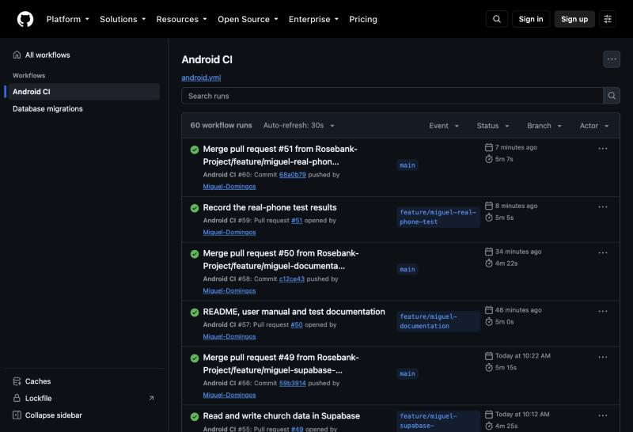
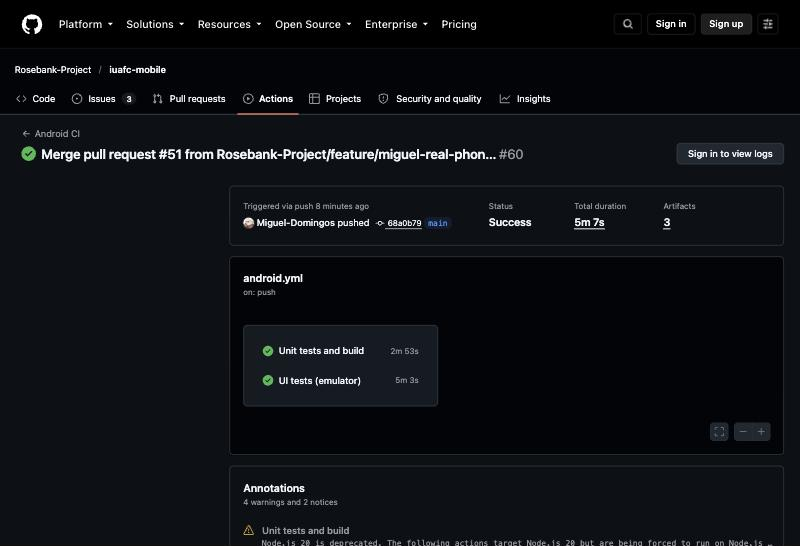
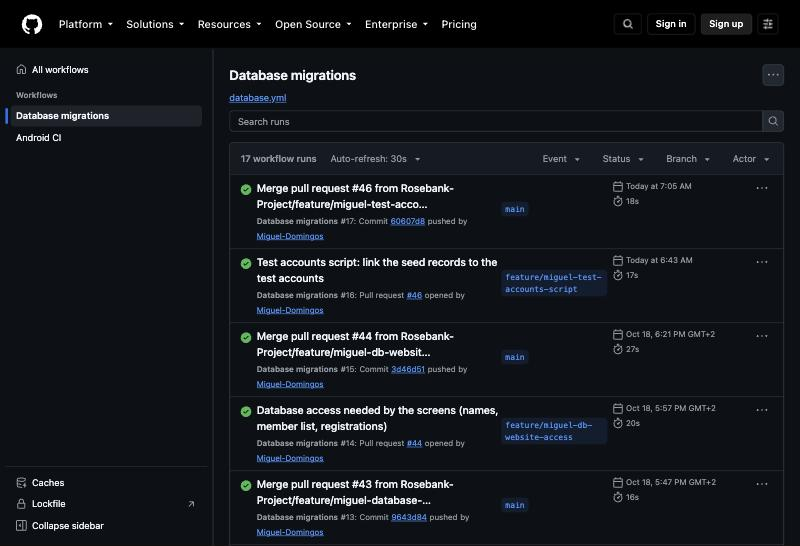

# Test documentation

How the IUAFC app was verified and tested: automated tests that run on every change, manual test cases
run on the emulator against the real Supabase database, and the bugs those tests found.

- [1. Approach](#1-approach)
- [2. Automated tests](#2-automated-tests)
- [3. Continuous integration (GitHub Actions)](#3-continuous-integration-github-actions)
- [4. Manual test cases](#4-manual-test-cases)
- [5. Invalid input](#5-invalid-input)
- [6. Database security tests](#6-database-security-tests)
- [7. Bugs found and fixed](#7-bugs-found-and-fixed)
- [8. Testing on a real phone](#8-testing-on-a-real-phone)

## 1. Approach

| Level | What is tested | Tool | When it runs |
|---|---|---|---|
| Unit tests | Input validation, the ViewModels of every feature (with fake repositories), navigation and role rules, sample data, dashboard, initials | JUnit 4, kotlinx-coroutines-test | Every pull request and push to `main` (GitHub Actions) |
| UI tests | The sign-in form and the member form, on a real Android system | Compose UI tests (instrumented) | Every pull request and push, on an Android emulator in GitHub Actions |
| Manual tests | Every screen and role, end to end, against the real Supabase project | Pixel 8 emulator (API 37), demo mode and real accounts | Before each pull request was merged (results in the pull request) |
| Database tests | Row Level Security for every role, migrations, seed data | Temporary PostgreSQL 17 database with all migrations applied | Before each database pull request was merged |
| Code review | Every pull request reviewed by the tech lead before merging, with emulator testing | GitHub pull requests | Every pull request |

Test accounts (one per role) are described in [database.md](database.md#test-accounts).

## 2. Automated tests

**87 automated tests: 81 unit tests and 6 UI tests.** All pass on `main`.

### Unit tests – `app/src/test` (81)

| Test class | What it checks | Tests |
|---|---|---|
| `util/ValidatorsTest` | Required fields, email format, password rules, password confirmation, South African phone numbers, positive amounts, date format, no future dates | 8 |
| `util/InitialsTest` | Avatar initials (first + last name, two names, one name, extra spaces, empty) | 5 |
| `navigation/AppDestinationTest` | Same bottom bar for every role; only Administrators manage users; Church Members see only their own attendance and donations; Finance Officers can't open Members or Reports; Settings and Help for everyone | 5 |
| `data/mock/MockDataTest` | At least 10 records per table, unique ids, every reference points to an existing record, members pass the app's validation, positive donation amounts | 5 |
| `data/repository/DashboardRepositoryTest` | Announcement count on the Administrator dashboard, only the 3 latest announcements shown, count updates after a new announcement | 3 |
| `data/repository/MockChurchFeaturesRepositoryTest` | Ministries added and updated, duplicate names rejected, ministries shared with the member form, activity review saves status and note, unique receipt numbers | 4 |
| `ui/screens/auth/LoginViewModelTest` | Empty form and invalid email don't call the server, valid sign-in, wrong password message, typing clears the error, Google sign-in success / cancelled / picker error / server error | 9 |
| `ui/screens/auth/RegisterViewModelTest` | All errors on an empty form, weak password, passwords don't match, account created, email confirmation required, existing email | 6 |
| `ui/screens/auth/ForgotPasswordViewModelTest` | Invalid email, reset link sent, server error shown | 3 |
| `ui/screens/members/MembersViewModelTest` | Sorted by name, search by name / email / phone, ministry filter, newest first, no matches | 5 |
| `ui/screens/members/MemberDetailViewModelTest` | Member and ministry shown, unknown member error, delete | 3 |
| `ui/screens/members/MemberFormViewModelTest` | Required fields, future date of birth, invalid phone, new member saved, duplicate email, edit and save | 6 |
| `ui/screens/users/UsersViewModelTest` | Role filter and counts, search, change role, the last Administrator can't be demoted, a Ministry Leader needs a ministry, cancel without changes | 6 |
| `ui/screens/announcements/AnnouncementViewModelTest` | Load, create, edit and delete announcements | 4 |
| `ui/screens/features/ChurchFeatureViewModelsTest` | Zero amount rejected and receipt issued, members see only their donations, leaders can't submit for another ministry or a past date, Pastor reviews pending activities, duplicate ministry names, reports load | 6 |
| `ui/screens/features/EventsViewModelTest` | Events load, a Church Member registers for an event | 2 |
| `ui/screens/features/AttendanceViewModelTest` | Present and Absent statuses saved for the event | 1 |

### UI tests – `app/src/androidTest` (6)

| Test | Checks |
|---|---|
| `LoginScreenTest.emptyForm_showsRequiredErrors_andDoesNotSignIn` | "Email is required" and "Password is required" appear; no sign-in is attempted |
| `LoginScreenTest.invalidEmail_showsError_andDoesNotSignIn` | "Enter a valid email address" appears |
| `LoginScreenTest.wrongPassword_showsTheErrorMessage` | The server's message ("Incorrect email or password.") is shown |
| `MemberFormScreenTest.newMember_emptyForm_showsRequiredErrors` | Full name, contact number, email and address are required |
| `MemberFormScreenTest.invalidPhone_showsError_andIsNotSaved` | "12345" is rejected and the member is not changed |
| `MemberFormScreenTest.validChanges_areSaved_andTheFormCloses` | A valid phone number is saved and the form closes |

Run them locally:

```bash
./gradlew testDebugUnitTest          # unit tests – reports in app/build/reports/tests/
./gradlew connectedDebugAndroidTest  # UI tests – needs a running emulator or phone
```

## 3. Continuous integration (GitHub Actions)

| Workflow | Jobs | Trigger |
|---|---|---|
| [Android CI](../.github/workflows/android.yml) | **Unit tests and build** – runs the unit tests, builds the debug APK, uploads the test reports and APK. **UI tests (emulator)** – starts an API 34 emulator and runs the UI tests. | Every pull request and every push to `main` |
| [Database migrations](../.github/workflows/database.yml) | **Check migrations (dry run)** on pull requests; **Apply migrations** to Supabase on `main` | Pull requests and pushes that change `supabase/` |

Latest results on `main` (19 October 2026):

| Workflow | Job | Result | Duration | Run |
|---|---|---|---|---|
| Android CI | Unit tests and build | ✅ success | 2 min 53 s | [#39236648804](https://github.com/Rosebank-Project/iuafc-mobile/actions/runs/39236648804) |
| Android CI | UI tests (emulator) | ✅ success | 5 min 3 s | [#39236648804](https://github.com/Rosebank-Project/iuafc-mobile/actions/runs/39236648804) |
| Database migrations | Apply migrations | ✅ success | – | [#39202745250](https://github.com/Rosebank-Project/iuafc-mobile/actions/runs/39202745250) |

Over the project, Android CI ran 60 times (52 successful) and Database migrations 17 times (15 successful).
The failed runs are the ones that caught problems before merging, for example a broken build in a pull
request and an expired Supabase access token.

Android CI runs (every pull request and every push to `main`):



Latest run on `main` – both jobs passed and the APK and test reports were uploaded as artifacts:



Database migrations – dry run on pull requests, applied on `main`:



## 4. Manual test cases

Environment: Pixel 8 emulator (Android API 37). "Real data" means the debug build connected to the Supabase
project with the test accounts; "demo" means demo mode with sample data. Dates are in October 2026.

### Accounts and sign-in

| ID | Feature | Steps | Expected | Actual | Result |
|---|---|---|---|---|---|
| TC-01 | Sign in – empty form | Tap **Sign in** with both fields empty | "Email is required", "Password is required" | As expected | ✅ Pass |
| TC-02 | Register – empty form | Open **Register**, tap **Register** | An error under each of the 4 fields | "Full name is required", "Email is required", "Password is required", "Please confirm your password" | ✅ Pass |
| TC-03 | Sign in – real account | Sign in as `admin@iuafc.org` | Home opens with the account's name and role | "Welcome back, Pastor John Williams", Administrator menu | ✅ Pass |
| TC-04 | Google sign-in (SSO) | Tap **Continue with Google**, pick an account | Signed in; account created on first use | Worked on the app and on the website (tested by the tech lead) | ✅ Pass |
| TC-05 | Session kept | Close and reopen the app after signing in | Still signed in | Still signed in | ✅ Pass |
| TC-06 | Forgot password | Enter an invalid email, then a valid one, and tap **Send reset link** | Error for the invalid email; link sent for the valid one | Covered by `ForgotPasswordViewModelTest` (no real email sent during testing) | ✅ Pass (unit test) |
| TC-07 | Role-based menu | Sign in as each of the 5 roles and open **Menu** | Only that role's screens | Admin: Users, Members, Ministries, Activities, Attendance, Donations, Reports; Pastor: the same without Users; Finance Officer: Donations; Ministry Leader: Ministries, Activities, Attendance; Church Member: My Attendance, Donations (plus Notifications, Settings and Help for everyone) | ✅ Pass |

### Settings

| ID | Feature | Steps | Expected | Actual | Result |
|---|---|---|---|---|---|
| TC-10 | Edit profile – invalid phone | Settings → Edit Profile, phone "12345", **Save Changes** | Error, not saved | "Enter a valid phone number (e.g. 0821234567)" | ✅ Pass |
| TC-11 | Edit profile – save name | Change the name and save | Name updated in Settings and in the header initials | Header changed to the new initials | ✅ Pass |
| TC-12 | Theme | Settings → Theme → Dark, then Light | Whole app changes theme; choice remembered | As expected | ✅ Pass |
| TC-13 | Help | Settings → Help & Support → Help | Help screen with questions per feature | As expected | ✅ Pass |

### Members, users and ministries

| ID | Feature | Steps | Expected | Actual | Result |
|---|---|---|---|---|---|
| TC-20 | Members list (real data) | Admin → Menu → Members | The 12 members from the database | "12 of 12 members" | ✅ Pass |
| TC-21 | Add / edit / remove member (website, real data) | Add "TEST Member", reload, edit phone, reload, remove | Each change kept after reload; removed at the end | As expected | ✅ Pass |
| TC-22 | Users – change role | Admin → Users → tap a user → choose a role (and member record or ministry) → Save | Role saved; last Administrator can't be demoted | Dialog checked on the emulator; saving and the last-Administrator rule covered by `UsersViewModelTest` | ✅ Pass |
| TC-23 | Ministries with leaders (real data) | Admin → Ministries | 10 ministries with the leaders' names | Choir Ministry – Brother Paul Adewale; Men's Ministry – Thabo Nkosi … | ✅ Pass |
| TC-24 | New ministry appears in member form | Create "Hospitality Ministry", open Add member → Ministry | New ministry listed | Listed | ✅ Pass |

### Events and attendance

| ID | Feature | Steps | Expected | Actual | Result |
|---|---|---|---|---|---|
| TC-30 | Events – upcoming and past | Open **Events** | Upcoming first (soonest on top), then past | "Upcoming (4)", "Past (6)" | ✅ Pass |
| TC-31 | New event – empty form | Admin → New Event → Save | Error, not saved | "Please fill in all required fields." | ✅ Pass |
| TC-32 | New event – past date | Open the calendar | Days before today can't be picked | 16–18 Oct disabled, 19 Oct (today) enabled | ✅ Pass |
| TC-33 | Create and delete event (real data) | Create "TEST Event" for today, then delete it | Event listed; deleting asks for confirmation and removes it | "Delete event? Are you sure…"; removed, Upcoming back to 4 | ✅ Pass |
| TC-34 | Register for an event | Church Member → Events → **Register for Event** | Button changes to Unregister | As expected | ✅ Pass |
| TC-35 | Attendance – must mark everyone | Leader → Attendance → event → Save without marking | Error, not saved | "Please mark all members Present or Absent before saving." | ✅ Pass |
| TC-36 | Attendance – save (real data) | Mark all 12 members and save; restart the app; reopen the event | "Saved!"; statuses loaded from the database | Saved; all 12 shown as Present after restart | ✅ Pass |
| TC-37 | Attendance – leader's members only | Choir leader → Attendance | Only Choir Ministry members | Grace Adeyemi, Daniel Okeke, Ruth Eze | ✅ Pass |
| TC-38 | My attendance | Church Member → My Attendance | Only their own records | Sunday Service – Present, Heritage Day Thanksgiving – Present | ✅ Pass |

### Donations, activities, announcements, reports

| ID | Feature | Steps | Expected | Actual | Result |
|---|---|---|---|---|---|
| TC-40 | Donation – empty form | Finance Officer → Record donation → Record | Error, not saved | "Donation date is required" | ✅ Pass |
| TC-41 | Donation – future date | Open the calendar | Days after today can't be picked | Future days disabled | ✅ Pass |
| TC-42 | Record donation | Grace, R500, Tithe, Cash, today → Record | Saved with the next receipt number | "R500,00 … Receipt RCP-1013" at the top | ✅ Pass |
| TC-43 | Receipt numbers from the database (website, real data) | Record a donation on the website | Receipt generated by the database | RCP-1013 | ✅ Pass |
| TC-44 | Member sees own donations only | Church Member → Donations | Only their own | 3 donations, R7 500 (Grace) | ✅ Pass |
| TC-45 | Propose activity – past date | Leader → Propose activity → calendar | Past days disabled | Disabled | ✅ Pass |
| TC-46 | Review activity | Pastor → Activities → Pending → Review request → Approve with note | Status Approved, note shown | As expected | ✅ Pass |
| TC-47 | Announcement – create, restart, delete (real data) | Admin creates "TEST Supabase", force-stops and reopens the app, then deletes it | Still there after restart with the author; gone after deleting | As expected | ✅ Pass |
| TC-48 | App ↔ website | Post "TEST sync" on the website, check the database | Saved in the same `announcements` table the app reads | Row found with a database id and the admin as author | ✅ Pass |
| TC-49 | Notifications | Open Notifications after a new announcement | New notification, unread count goes up | 25 → 26 unread | ✅ Pass |
| TC-50 | Reports | Admin → Reports | Membership, giving and attendance summaries | 12 members (6 men, 6 women), members by ministry, giving by month, attendance by event | ✅ Pass |

## 5. Invalid input

The app must never crash on invalid input. Every case below shows a message and keeps the user on the form.

| Input | Where | Message |
|---|---|---|
| Empty required field | Every form | "<Field> is required" |
| Invalid email | Sign in, register, members | "Enter a valid email address" |
| Weak password | Register | "Password must be at least 8 characters" / "must contain letters and numbers" |
| Passwords don't match | Register | "Passwords do not match" |
| Invalid phone ("12345") | Members, profile | "Enter a valid phone number (e.g. 0821234567)" |
| Amount ≤ 0 or not a number | Donations | "Amount must be greater than zero" / "Enter a valid amount" |
| Future date | Donation date, date of birth, join date | Blocked in the calendar and rejected by the ViewModel |
| Past date | New event, proposed activity | Blocked in the calendar and rejected by the ViewModel |
| Duplicate member email | Members | "This email is already registered to another member." |
| Duplicate ministry name | Ministries | "A ministry with this name already exists." |
| No internet | Any screen | "No internet connection. Check your connection and try again." with **Try again** |
| Change not allowed for the role | Any change | "You don't have permission to do this." |

## 6. Database security tests

Before each database change was merged, every migration was applied to a temporary PostgreSQL 17 database
and each action was run as a signed-in user of each role (the same way Supabase applies Row Level Security).
Details are in pull requests #41–#44 and #46.

| Test | Expected | Result |
|---|---|---|
| Administrator adds a member, an event, a ministry | Allowed | ✅ |
| Church Member reads the member list | Only their own record | ✅ |
| Church Member adds a member, event or ministry | Blocked by RLS | ✅ |
| Finance Officer records a donation | Allowed; receipt number generated | ✅ |
| Pastor reads donations; Church Member reads donations | Pastor: all; member: only their own | ✅ |
| Ministry Leader proposes an activity for another ministry, or one already Approved | Blocked | ✅ |
| Ministry Leader approves their own activity | 0 rows changed | ✅ |
| Gender "Other", donation type "Building Fund", attendance "Late" | Rejected by check constraints (the app doesn't know these values) | ✅ |
| Deleting a member | Account kept, link cleared; donations kept | ✅ |
| Signed out user calls `profile_directory()` | Permission denied | ✅ |
| Seed migration run twice | No duplicates | ✅ |

## 7. Bugs found and fixed

Bugs found by the tests and code reviews above, all fixed before merging.

| Bug | Found in | Fix |
|---|---|---|
| Top bar disappeared from every other screen | Review of #36 | Default restored in `ScreenScaffold` |
| New announcements lost when switching tabs | Review of #36 | Shared repository in `AppContainer` |
| "Upcoming Events" showed 3 instead of 5 | Review of #36 (now a unit test) | Count before limiting the list |
| New announcements showed "By Unknown" | Review of #36 round 2 | Author resolved from the user list |
| Donations could be recorded in the future | Review of #39 | Calendar and ViewModel reject future dates |
| Validation errors stayed after closing the form | Review of #39 | Errors cleared when a dialog opens or closes |
| A new ministry didn't appear in the member form | Review of #39 | One ministry list for the whole app |
| Migration failed (columns already existed) | Database test of #41 | Foreign keys added instead of new columns |
| Administrators couldn't add members or events; members could read everyone's phone number | Database test of #41 | Write and read policies per role |
| Column names didn't match the app | Review of #41 / #42 | Alignment migration (#42) |
| Attendance saved with today's date instead of the event's | Review of #45 | Event date used |
| Ministry Leaders saw every member when capturing attendance | Review of #45 | Filtered by the leader's ministry |
| New events could be scheduled in the past; created by "user-1" | Testing of #45 | Calendar blocks past days; signed-in user saved as creator |
| Menu showed different initials from the header ("PJ" vs "PW") | Manual testing for this document | One `initialsOf()` for every avatar, with unit tests |

## 8. Testing on a real phone

The final app must run on a physical Android phone. Install the APK built on the tech lead's computer
(Google sign-in only works with that signing key), then repeat test cases TC-01 to TC-50 with the test
accounts. Record any bug as a GitHub issue with the `bug` label.

| Phone | Android version | Date | Tester | Result | Bugs (issues) |
|---|---|---|---|---|---|
| Samsung Galaxy A35 | Android 16 | 2026-10-19 | Rolph | Pass – TC-01 to TC-50 passed (5 test accounts and Google sign-in) | None |

The APK installed and ran on the phone with the same results as on the emulator: every role saw only its
own screens, data saved on the phone appeared on the website, and no crashes or new bugs were found, so
no bug issues were opened.
